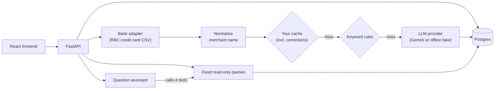

# spendlens

Upload a credit card statement, get your spending sorted into categories, see it on a
dashboard, and ask questions about it in plain English. The categorizer is a three-step
pipeline (your corrections, then keyword rules, then an LLM) that sends the model as
little as possible, and its accuracy is measured against hand-labeled data.

<!-- TODO: add a screenshot or short demo GIF here, e.g. docs/screenshots/dashboard.png -->

**What it does**
- **Import:** upload an RBC credit card CSV. Re-uploading the same file adds nothing.
- **Categorize:** every transaction gets a category, how it was decided, and a confidence.
  Uncertain ones are flagged for review.
- **Review:** confirm a category with one click or change it. Your choice is remembered
  for that merchant and applied to your other transactions from it.
- **Dashboard:** totals, spending by category and month, and top merchants, with date filters.
- **Ask:** questions like "How much did I spend on dining in March 2024?" are answered from
  your real numbers, and the answer shows which queries produced it.

## How it works



Most merchants never reach the model. Whatever does is sent as a bare merchant name, one
request per batch, and the answer is saved so each merchant is only ever asked about once.

**Built with:** Python, FastAPI, SQLAlchemy 2.0, Alembic, PostgreSQL 16, Docker
Compose, pytest, GitHub Actions; React, TypeScript, Vite and Recharts; Gemini API.

## Design decisions

- **Bank adapters.** Each bank's CSV format sits behind a small `BankAdapter` interface.
  Only RBC credit card is implemented; adding a bank means writing one parser.
- **Money is integer cents.** No floating point. Spending is positive, refunds are negative.
- **Idempotent imports.** Each row gets a hash (date, amount, description and a per-file
  occurrence counter, so two identical purchases on one day both survive). A unique
  constraint on `(account_id, row_hash)` makes re-uploads and overlapping statements safe.
- **Card payments are not spending.** They are marked as transfers and left out of totals.
- **Per-user isolation.** Every query is scoped to the signed-in user, and another user's
  record returns the same 404 as a missing one, so ids can't be probed. Isolation is
  tested for accounts, uploads, transactions, the cache, the dashboard and the assistant.
- **Privacy by construction.** The categorizer only receives normalized merchant names and
  the category list. Amounts, dates and account details never leave the app. The
  provider interface takes `list[str]`, so it can't be handed anything else, and a test
  checks the request body.
- **The model never writes SQL.** The assistant can call four fixed, parameterized
  queries and set only dates and a limit. The server supplies the user id.
- **Model failures never fail a request.** Timeouts, rate limits and malformed output
  fall back to low-confidence `Other`, flagged for review and not cached.
- **Model output is untrusted.** Categories are validated against a fixed list, and the
  number of answers must match the number of questions.

## Security

- Passwords are hashed with Argon2id.
- Login tokens are signed JWTs (HS256). The server refuses to issue tokens with a
  `JWT_SECRET` shorter than 32 characters.
- A wrong password and an unknown email return the same error, and an unknown email
  still does a password hash so response times don't reveal which accounts exist.
- API keys are sent in headers, never logged, and redacted from error messages.
- `.env` is git-ignored. Real bank exports are git-ignored too (`*.csv`), apart from a
  synthetic fixture and the evaluation labels.

## Running it locally

You need Python 3.11 or newer (CI uses 3.12), Docker, and Node 20 or newer.

```bash
# 1. Configuration
cp .env.example .env
#    Edit .env: choose a database password made of letters and numbers only, and use the
#    same one in DATABASE_URL. Set JWT_SECRET to a long random value:
#    python3 -c "import secrets; print(secrets.token_urlsafe(48))"

# 2. Database
docker compose up -d db

# 3. Backend
python3 -m venv .venv && source .venv/bin/activate
pip install -r backend/requirements-dev.txt
cd backend
set -a; source ../.env; set +a
alembic upgrade head
uvicorn app.main:app --reload          # API docs at http://127.0.0.1:8000/docs

# 4. Frontend (in a second terminal)
cd frontend
npm install
npm run dev                            # app at http://localhost:5173
```

The database is exposed on host port 5433 to avoid clashing with a local Postgres. A
synthetic statement to try is in `tests/fixtures/rbc_credit_card_sample.csv`. The default
`LLM_PROVIDER=fake` works offline; see "Categorization providers" below to use Gemini.

**Tests**

```bash
pytest                                  # backend, no database or network needed
cd frontend && npm test && npm run typecheck
```

The backend tests use an in-memory SQLite database and a fake model, so they run anywhere.
GitHub Actions runs the backend suite on every push.

## API overview

| Endpoint | Purpose |
| --- | --- |
| `POST /auth/register`, `POST /auth/login`, `GET /auth/me` | Sign up, sign in, current user |
| `GET/POST /accounts` | The user's card accounts |
| `POST /uploads` | Upload a statement CSV into an account |
| `GET /transactions` | List, with `needs_review`, `category`, `limit`, `offset` |
| `PATCH /transactions/{id}` | Correct a category |
| `GET /categories` | The fixed category list |
| `GET /dashboard/summary`, `/by-category`, `/by-month`, `/top-merchants` | Spending queries, with `start`, `end`, `account_id` |
| `POST /assistant/ask` | Ask a question about your spending |
| `GET /health` | Liveness check |

Interactive docs are served at `/docs`.

## Categorization providers

Each transaction is categorized by the first step that knows its merchant:

1. **Your cache.** Categories remembered for your merchants, including your own corrections.
2. **Keyword rules** in `backend/app/categorization/rules.py`.
3. **An LLM provider**, for whatever is left. Unknown merchants are sent once each, in batches.

Pick the provider with `LLM_PROVIDER` in `.env`:

| `LLM_PROVIDER` | What it does |
| --- | --- |
| `fake` (default) | Offline and deterministic. Used by the tests; good for local development. |
| `gemini` | Calls the Gemini API. Needs `GEMINI_API_KEY`; `GEMINI_MODEL` defaults to `gemini-3.5-flash-lite`. |

With `LLM_PROVIDER=gemini` and no key, the API refuses to start.

Gemini also gets a one-line definition of each category, from `CATEGORY_DEFINITIONS` in
`backend/app/categorization/categories.py`. Those definitions set conventions such as
"postage and government services are Other" and "liquor stores are Shopping". Edit
them to change how merchants are categorized, then rerun the evaluation below.

**What is sent.** Only the normalized merchant names (such as `TIM HORTONS`) and the
category list. Amounts, dates, card numbers and account details never leave the app.
On Gemini's free tier, Google may use what you send to improve its products.

**When Gemini fails.** A timeout, HTTP error, rate limit or malformed reply never
fails an upload. That batch's merchants are saved as `Other` with low confidence and
`needs_review` set, and they are not cached, so they are retried on the next upload.
Rate limits and server errors get one retry after a short wait. The API key is sent
in a header and is never logged.

## Correcting categories

`PATCH /transactions/{id}` with `{"category": "Groceries", "apply_to_merchant": true}`
sets a transaction's category. It returns the updated transaction plus `also_updated`,
the number of other transactions changed.

- **The transaction** gets the category with `category_source = "user"`, confidence 1.0
  and `needs_review` cleared.
- **Your merchant cache** gets a `user` entry for the transaction's merchant (for
  example `TIM HORTONS`). Uploads check your cache before the rules and the LLM, and
  an LLM answer never overwrites a `user` entry, so every later upload of that merchant
  gets your category without asking the model. Correcting the same merchant again
  replaces the entry.
- **With `apply_to_merchant` (the default)**, your other transactions from the same
  merchant change too. Transfers are skipped, and so are rows you corrected yourself,
  so an earlier deliberate choice is never overwritten. With `false`, only that
  transaction changes, but the merchant is still remembered for future uploads.

All three changes happen in one database transaction. Corrections are per user and
never affect anyone else's categories or cache. Transfers (card payments) can't be
recategorized (400), and the category must be one of the fixed categories (422).
Dashboards and the assistant read the transaction rows, so they reflect corrections
straight away.

To build a review queue, `GET /transactions` takes `needs_review=true` and
`category=<name>` filters alongside `limit` and `offset`.

## Question assistant

`POST /assistant/ask` with `{"question": "How much did I spend on dining last month?"}`
returns `{"answer": ..., "tool_calls": [...]}`, listing the tools that were run.

**Design.** The model never sees your transactions. It can only call four read-only
tools, which are thin wrappers over the same functions the dashboard uses
(`backend/app/queries.py`): `spending_summary`, `spending_by_category`,
`spending_by_month` and `top_merchants`.
- The model may set only `start`, `end` and, for `top_merchants`, `limit`. The server
  always supplies the signed-in user's id, and the model has no way to name an account,
  so a question can only ever read your own data.
- Every argument is checked on the server. A bad call, such as an unknown argument,
  an invalid date, `end` before `start` or a `limit` outside 1–50, is sent back to the
  model as an error so it can correct itself.
- The loop is bounded: at most 4 model round trips, then a polite "I couldn't answer
  that".
- The system prompt includes today's date, so "last month" resolves correctly. It
  tells the model to answer only from tool results, to convert cents to dollars, and
  to treat the question and merchant names as data, not instructions.

The assistant uses the same `LLM_PROVIDER` setting as categorization: `fake` is a
scripted, offline assistant, and `gemini` uses Gemini function calling with the same
key handling, timeout and retry.

**What is sent to the model.** Your question, plus the aggregate tool results: totals
in cents, transaction counts, dates in the range, category names and merchant names.
Raw descriptions, individual transactions, card numbers and account details are
never sent.

**Failures.** If Gemini times out, errors or is rate limited (after one retry), the
endpoint returns 503 with a short message. Blocked or malformed output returns 200
with "I couldn't answer that". Neither includes a stack trace. Logs record the
question's length and the tool names, never the question text or the API key.

## Evaluating the categorizer

`eval/run_eval.py` measures how well categorization matches your hand labels in
`eval/labeled_merchants.csv` (columns `description,category`). It runs each description
through the real pipeline order (normalize, then rules, then the provider) with no
cache and no database, so Postgres doesn't need to be running.

```bash
python eval/run_eval.py                          # uses LLM_PROVIDER, default fake
set -a; . ./.env; set +a; python eval/run_eval.py   # with your Gemini settings
python eval/run_eval.py --json                   # machine-readable output
```

The script prints a table and writes the same report to
`eval/results/<provider>-<date>.md`. That folder is git-ignored, so reports stay local.
The two eval CSVs are committed, so CI runs the rules guard below.

The file is checked before anything runs: every category must be one of the fixed
categories, and descriptions must be non-blank and unique. The script reports every
problem with its line number and changes nothing.

**Reading the numbers**
- **Overall / Rules / Provider:** accuracy over all rows, and within the rows each
  layer handled. `Correct` counts only scored rows, so it always matches `Accuracy`.
  The `Failed` column beside it shows rows whose provider batch got no answer. With the `fake` provider, only the Rules line is meaningful. The fake
  calls most merchants `Other` at 0.4 by design.
- **Confident vs Flagged needs_review:** accuracy of rows above and below the review
  threshold (0.7). Confident rows should be very accurate. Flagged rows are the ones
  you will be asked to check.
- **Wrong answers flagged (recall):** of the wrong answers, how many were flagged for
  review. A wrong answer that isn't flagged goes into your totals silently, so this is
  the number to watch.
- **Most common mistakes / Wrong answers:** where to look when adding rules or
  fixing normalization.
- **Failed rows:** rows whose provider batch got no answer (timeout, HTTP error, rate
  limit, malformed reply). They are left out of every accuracy figure rather than
  counted as wrong.
- **Should-flag check:** each description in `eval/should_flag.csv` is ambiguous on
  purpose. The report says "flagged X of N" and lists any that came back confident.
  These rows don't count toward accuracy.

The Run table records the provider, model, temperature, date, row counts, the
review threshold, a hash of each input file and the git commit, so two reports can be
compared fairly.

`tests/test_eval.py` checks the harness on a built-in sample with the fake provider,
so CI needs no key. It also guards the rules: on the rows your rules match, they must
stay at or above 95% accuracy and 82 correct (currently 100%, 86 of 86). That test skips when the labeled file isn't present.

## Evaluation results

Measured with `eval/run_eval.py` using `gemini-3.5-flash-lite` at temperature 0.

| Set | Rows | Accuracy | Notes |
| --- | --- | --- | --- |
| Tuning set (`eval/labeled_merchants.csv`) | 166 | 98.8% (164/166) | The rules and prompt were tuned using this set, so it is optimistic |
| Held-out set (`eval/holdout.csv`) | 30 | 96.7% (29/30) | Written before the run and not used for tuning |

On the tuning set the rules got 88 of 88 right and the model 76 of 78 (97.4%). On the
held-out set the rules got 5 of 6 and the model 24 of 24. Without a model (the offline
fake provider) the same tuning set scores 57.8%: the rules settle about half of the
merchants and the model handles the rest.

The held-out set is small, so one row is worth about 3 percentage points.

**What the evaluation found and fixed:** processor prefixes (`DD *`, `SP *`) were
removing merchant names, text after `*` was being cut off, `GAS BAR` matched the `BAR`
rule, `AMAZON PRIME` matched `AMAZON`, and a batch of 50 merchants was rejected by Gemini
because of an over-strict response schema. A miss on the held-out set (`UBER* ONE
MEMBERSHIP` categorized as Transport) led to a fix for multi-service brands, so that
set was no longer a clean test afterwards and the result above is from before the fix.

## Known limitations

- **Confident mistakes are not flagged.** None of the 3 wrong answers across both sets
  had a confidence below the review threshold, so they were not flagged. A user only
  catches them by looking. Merchants with cryptic names (such as `RFBT-TORONTO YONGE ST`,
  a bubble tea shop) can fool the model with high confidence.
- **Brand rules are hand-maintained.** Brands that sell several services (Uber, Amazon,
  Google) need specific rules, and a brand not on the list can have the same problem.
- **One bank format.** Only the RBC credit card CSV is supported, in CAD.
- **Browser storage.** The login token is kept in `localStorage`, which is simple but
  readable by any script running on the page.
- **Not built yet:** rate limiting on login, password reset, email verification, a
  frontend job in CI, and a hosted demo.

## Roadmap

- More bank adapters (RBC chequing, CIBC).
- A local model provider (Ollama) for fully offline categorization.
- Rate limiting and a deployed demo.

## License

MIT. See `LICENSE`.
